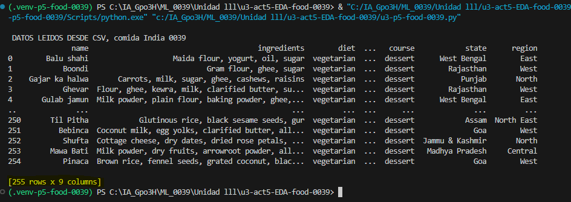
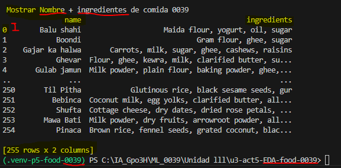
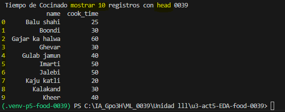
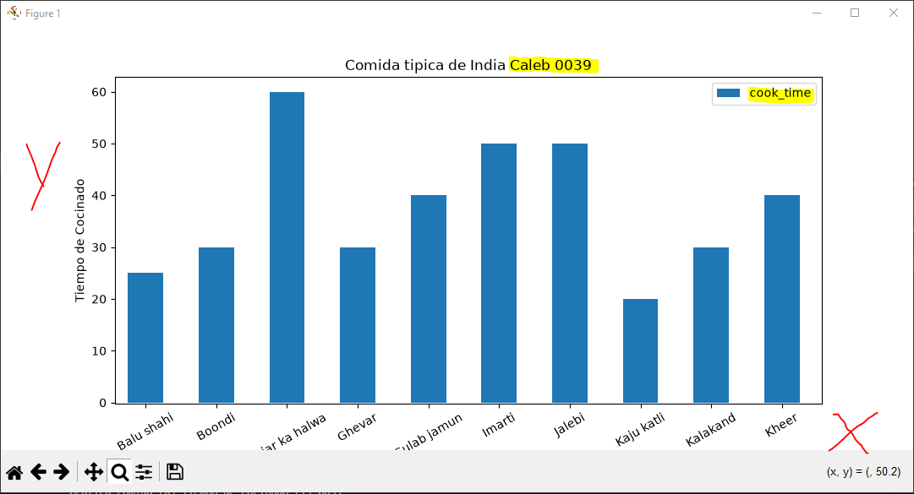
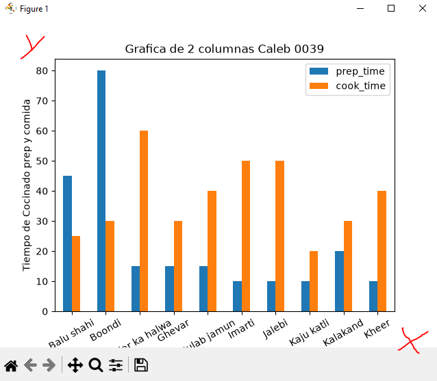
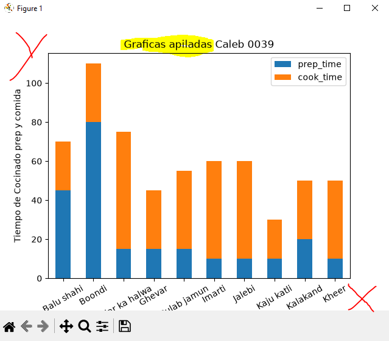

## Analisis exploratorio de datos
## Comida del pais India
## Caleb Dorado NC = 0039
### +-+-+ Importando Data del archivo CSV comida de india +-+-+

### +-+-+ Mostrar Nombre de comida + ingredientes +-+-+

### +-+-+ Tiempo de Cocinado mostrar 10 registros con head +-+-+

## Creacion de Graficos de barras 0039

## Grafica de varias columnas

## Grafica apilada
